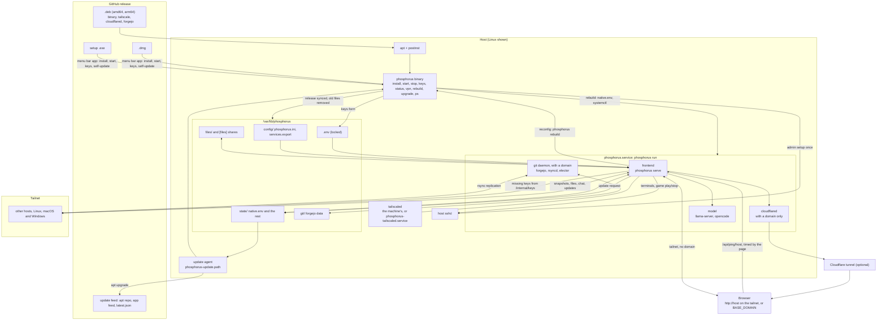

  

<h1 align="center">Phosphorus</h1>

<b>Every computer you own, as one desktop in your browser.</b>

  
  
  

  <a href="https://github.com/pmghartman/phosphorus/releases/latest">Download</a> ·
  <a href="#quick-start">Quick start</a> ·
  <a href="#everyday-use">Everyday use</a> ·
  <a href="#architecture">Architecture</a>

## Features

- **Terminals** on every host in browser windows, with `ssh <host>` to any peer
- **Files** across all hosts as one home, with a shared live editor and chosen files mirrored to every host
- **Services and game servers**, proxied by path or subdomain and started from the desktop
- **Chat**, live **status** and notifications, shared by the mesh
- **Git** on Forgejo, replicated to every host with an elected master
- **A local AI model**, hosted on one machine for all of them, with projects it works on alone in a sandbox
- **An MCP server** at `/api/mcp`: Claude or any MCP client reads the mesh and acts on it with your rights, running scripts on each host with your saved login and working on Forgejo with your saved git login; the agent button copies its url for any agent's MCP connector (web, desktop, phone), or downloads a Claude plugin (Claude Code, Cowork) of mesh skills and an operator agent that work through that connector, no key inside; with **show agent on screen** checked, every call it makes opens and lights the window it works in: editors for its files, the files window where it browses, a console per host for its commands and logs, the status, chat and git views
- **Accounts** with admin roles and a per-user vault of host and page logins

## Quick start

You need a [Tailscale](https://tailscale.com) account (the free plan works) and a reusable auth key.

1. **Download** the host installer from the [latest release](https://github.com/pmghartman/phosphorus/releases/latest).
2. **Install** it:

   | | |
   |---|---|
   | macOS | Open the `.dmg`, drag Phosphorus to Applications, open it (first time: right-click, Open) |
   | Windows | Run the setup `.exe` (SmartScreen: More info, Run anyway) |
   | Linux | `sudo apt install ./phosphorus_VERSION_ARCH.deb`, then `sudo phosphorus` |

3. **Enter your Tailscale auth key.** Tailscale is installed if missing. Every other host copies the rest from the mesh.
4. **Open** `http://HOST` from any device on the tailnet, using a host's name or tailnet IP.

The first login is `admin` with your admin password. Create your own admin account and that login turns off.

### Optional

- **A domain:** a [Cloudflare](https://cloudflare.com) domain and tunnel token give you `https://your-domain` off the tailnet, plus git.
- **More keys:** a Tailscale API token (game server DNS) and an admin password, set on the first host.

Change keys later with **Edit Keys** in the menu bar or tray icon (a form in your browser, served on this machine only), or `phos keys`.

## Everyday use

| | |
|---|---|
| Menu bar / tray icon (macOS, Windows) | Open Phosphorus, Start, Stop, Check for Updates, Edit Keys, Uninstall, Quit; updates itself from the signed feed |
| `phos` | Terminal UI |
| `phos start` / `stop` / `status` | Control this host |
| `phos vpn on` / `off` | Tailscale up, or Phosphorus and Tailscale down |
| `phos update` / `update all` | Update this host, or every host in the mesh at once |
| `phos uninstall` | Remove Phosphorus and its data |

A model host downloads llama.cpp, opencode and the model, often several GB. You pick the model, so its license is yours to follow.

## Architecture

How the pieces fit

## License

Apache 2.0, see [`LICENSE`](LICENSE). Bundled software keeps its own license; full texts are in `THIRD_PARTY_LICENSES.txt`, included in every installer.

  

<i>The Alchymist, In Search of the Philosopher's Stone, Discovers Phosphorus</i>, Joseph Wright of Derby, 1771: Hennig Brand in 1669. Public domain, via <a href="https://commons.wikimedia.org/wiki/File:Joseph_Wright_of_Derby_The_Alchemist.jpg">Wikimedia Commons</a>.

