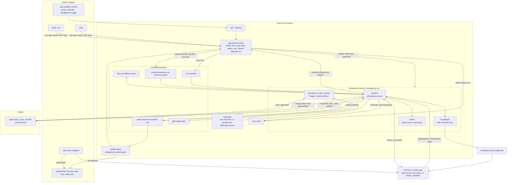

  

<h1 align="center">Phosphorus</h1>

<b>Every computer you own, as one desktop in your browser.</b>

  
  
  

  <a href="https://github.com/pmghartman/phosphorus/releases/latest">Download</a> ·
  <a href="#install">Install</a> ·
  <a href="#first-start">First start</a> ·
  <a href="#architecture">Architecture</a>

Terminals, files, web services, game servers, chat, live status, git and a local AI model, across all your machines: on your tailnet, or at your own domain.

## What you need

- A [Tailscale](https://tailscale.com) account (the free plan is enough) and a reusable auth key
- Optional: a domain on [Cloudflare](https://cloudflare.com) and a tunnel token, to reach the mesh off the tailnet and for git

## Install

Download from the [latest release](https://github.com/pmghartman/phosphorus/releases/latest).

**Host** (a machine that joins the mesh):

- **macOS**: open `phosphorus-VERSION-macos-universal.dmg`, drag Phosphorus to Applications and open it (the first time: right-click, Open).
- **Windows**: run `phosphorus-VERSION-windows-x86_64-setup.exe` (if SmartScreen warns: More info, Run anyway).
- **Linux**: `sudo apt install ./phosphorus_VERSION_ARCH.deb`, then `sudo phosphorus`.

Tailscale is installed on first start if it's missing. On macOS, allow its VPN configuration when asked.

**Client** (optional, a window onto the mesh from any computer): install `phosphorus-client` for your system and enter your domain, or any host's tailnet name. It updates itself. Hosts don't need it.

## First start

Phosphorus asks for its keys:

- **Tailscale auth key**: always needed. A machine joining an existing mesh needs nothing else; it copies the rest from the other hosts.
- **First setup** (all optional, first host only): your domain and Cloudflare tunnel token, a Tailscale API token (for game server DNS) and an admin password.

Then open `http://HOST` from any device on the tailnet (a host's name or tailnet IP), or `https://your-domain` with one. The first login is user `admin` with your admin password; create your own admin account and that login turns off.

To change a key later: **Edit Keys** in the tray, or `phos keys`.

## Everyday use

**Tray icon** (macOS and Windows): Start, Stop, Check for Updates, Edit Keys, Uninstall, Quit.

**Command line** (any host): `phos` opens the terminal UI. Also `phos start`, `phos stop`, `phos status`, `phos vpn off`, `phos vpn on`, `phos update`, `phos update all`, `phos uninstall`.

**Updating**: admins click the update icon in the web bar (or run `phos update all`) to update every host at once.

**A model host downloads a lot**: llama.cpp's `llama-server` (plus NVIDIA's CUDA runtime on an NVIDIA card), opencode, and the model itself, often several GB. Turning `host` off removes them. You pick the model, so following its license is up to you.

## Architecture

## The name

  

<i>The Alchymist, In Search of the Philosopher's Stone, Discovers Phosphorus</i>, Joseph Wright of Derby, 1771: Hennig Brand in 1669. Public domain, via <a href="https://commons.wikimedia.org/wiki/File:Joseph_Wright_of_Derby_The_Alchemist.jpg">Wikimedia Commons</a>.

## License

Apache 2.0, see `LICENSE`. Everything phosphorus bundles or downloads keeps its own license; the full texts are in `THIRD_PARTY_LICENSES.txt`, included in every installer.
