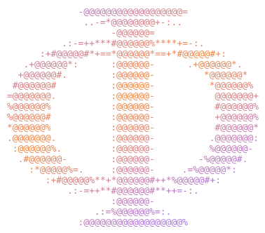

<h2 align="center">Phosphorus</h2>

<b>Every computer you own, as one desktop in your browser.</b>

  
  
  

Install it on each machine and they find each other. No servers to rent, no config files: one key, and your Macs, PCs and Linux boxes become one private mesh you can open from anywhere.

- **Terminals** on every host, a click away
- **One home folder** across every machine
- **Services and game servers**, started from the desktop
- **Git, chat and a local AI model**, shared by the whole mesh
- **Code sessions** with Claude Code or opencode on any host
- **Agents**: assign each mesh model to Claude Code and opencode from one page
- **An MCP server**, so Claude can work your mesh for you

## Quick start

Grab Phosphorus from the [**latest release**](https://github.com/pmghartman/phosphorus/releases/latest), which has install steps for every platform. Phosphorus needs a free [Tailscale](https://tailscale.com) auth key; then open `http://HOST` from any device on your tailnet.

## License

Apache 2.0, see [`LICENSE`](LICENSE). Bundled software keeps its own license; full texts ship in each installer as `THIRD_PARTY_NOTICES.txt`, generated at build time by `bun run licenses`.

  

<i>The Alchymist, In Search of the Philosopher's Stone, Discovers Phosphorus</i>, Joseph Wright of Derby, 1771: Hennig Brand in 1669. Public domain, via <a href="https://commons.wikimedia.org/wiki/File:Joseph_Wright_of_Derby_The_Alchemist.jpg">Wikimedia Commons</a>.

