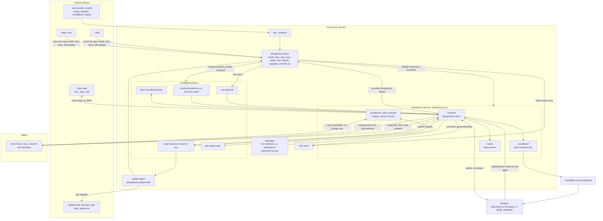

<h2 align="center">Phosphorus</h2>

<b>Every computer you own, as one desktop in your browser.</b>

  
  
  

Install it on each machine and they find each other. No servers to rent, no config files: one key, and your Macs, PCs and Linux boxes become one private mesh you can open from anywhere.

- **Terminals** on every host, a click away
- **One home folder** across every machine
- **Services and game servers**, started from the desktop
- **Git, chat and a local AI model**, shared by the whole mesh
- **Code sessions** with Claude Code or opencode on any host
- **Agents**: assign each mesh model to chat, inline suggestions, Claude Code and opencode from one page
- **An MCP server**, so Claude can work your mesh for you

<h2 align="center">Sulfur</h2>

<b>A code editor that lives on every machine at once.</b>

Open any file on any host and edit it live, together. Build with each machine's own compilers. Run it in the browser or as its own desktop app, on the mesh or fully offline.

- **Feels like VS Code**: palette, completion, extensions, themes
- **Live collaboration** on every file
- **Language servers** for ten languages, installed per host
- **Claude Code and opencode** agents in the editor
- **Self-updating** apps for macOS, Windows and Linux

## Quick start

Grab Phosphorus or Sulfur from the [**latest release**](https://github.com/pmghartman/phosphorus/releases/latest), which has install steps for every platform. Phosphorus needs a free [Tailscale](https://tailscale.com) auth key; then open `http://HOST` from any device on your tailnet.

<h2>Architecture</h2>

## License

Apache 2.0, see [`LICENSE`](LICENSE). Bundled software keeps its own license; full texts are in [`THIRD_PARTY_LICENSES.txt`](THIRD_PARTY_LICENSES.txt).

  

<i>The Alchymist, In Search of the Philosopher's Stone, Discovers Phosphorus</i>, Joseph Wright of Derby, 1771: Hennig Brand in 1669. Public domain, via <a href="https://commons.wikimedia.org/wiki/File:Joseph_Wright_of_Derby_The_Alchemist.jpg">Wikimedia Commons</a>.

